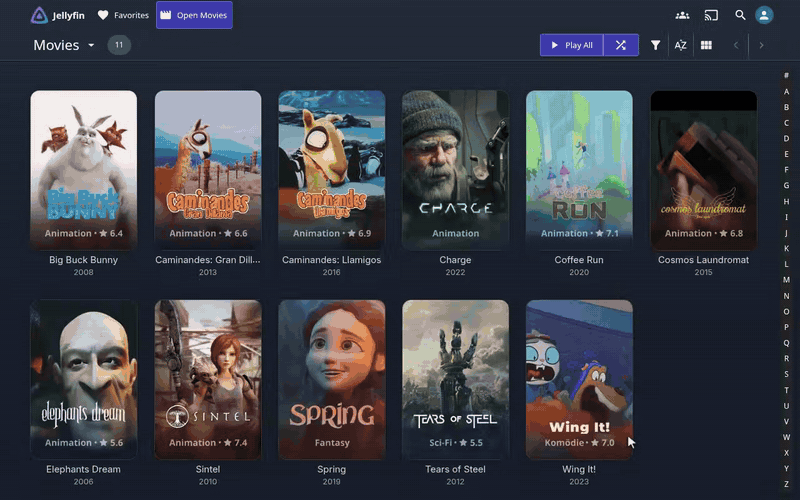
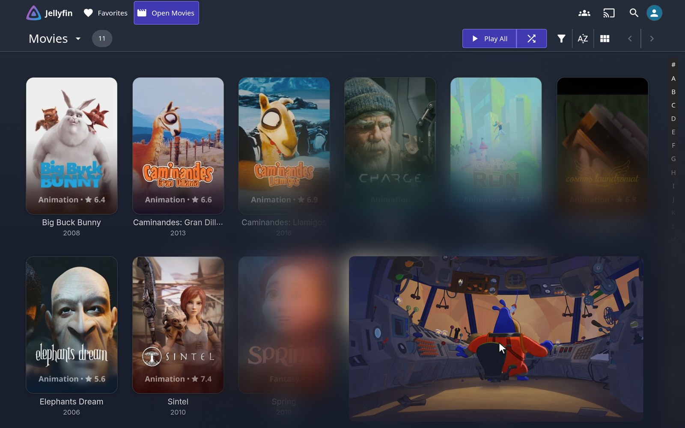
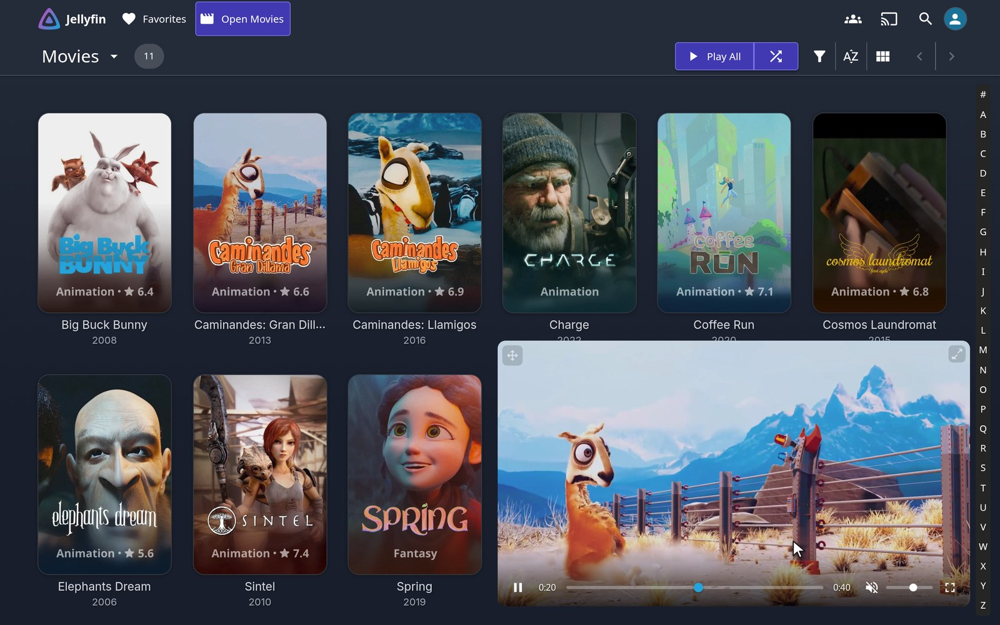

<p align="center">
  
</p>

<p align="center">
  <b>Trailer previews on hover for Jellyfin.</b><br>
  Point at a movie or series card and its trailer starts playing, like on Netflix.
</p>

<p align="center">
  <a href="https://github.com/Fovty/HoverTrailer/releases"></a>
  <a href="#compatibility"></a>
  <a href="https://github.com/Fovty/HoverTrailer/actions/workflows/build.yml"></a>
  <a href="https://github.com/Fovty/HoverTrailer/releases"></a>
  <a href="LICENSE"></a>
  <a href="https://ko-fi.com/fovty"></a>
</p>

HoverTrailer adds trailer previews to the Jellyfin web interface. It plays a local trailer file if the item has one, a YouTube trailer otherwise, and can fall back to the theme video. Position, size, background blur and player controls are set on the plugin's settings page.

## Demo

<p align="center">
  
</p>

<table>
<tr>
<td align="center"><b>Anchor to Card with Halo blur</b></td>
<td align="center"><b>Fix Position with player controls</b></td>
</tr>
<tr>
<td></td>
<td></td>
</tr>
</table>

## Install

Requires Jellyfin 12. For Jellyfin 10.11 see [Compatibility](#compatibility).

1. In the Jellyfin dashboard open **Plugins** → **Manage Repositories** and add this repository:
   ```
   https://raw.githubusercontent.com/Fovty/HoverTrailer/master/manifest.json
   ```
2. Recommended: install [File Transformation](https://github.com/IAmParadox27/jellyfin-plugin-file-transformation) (v2.2.1.0 or newer) first. HoverTrailer detects it and injects its script through it, so no file in Jellyfin's web directory is modified.
3. Back in **Plugins**, search for **HoverTrailer** and install it.
4. Restart the Jellyfin server.
5. Open **Plugins** → **HoverTrailer** to change the settings. Every option has a description next to it.

<details>
<summary>Manual installation</summary>

1. Download the zip of the latest [release](https://github.com/Fovty/HoverTrailer/releases).
2. Extract the `.dll` into a `HoverTrailer` folder in your Jellyfin plugins directory:
   - **Linux**: `/var/lib/jellyfin/plugins/HoverTrailer`
   - **Docker**: `/config/plugins/HoverTrailer`
   - **Windows**: `%ProgramData%\Jellyfin\Server\plugins\HoverTrailer`
3. Restart the Jellyfin server.

</details>

## Compatibility

| Jellyfin server | HoverTrailer release | Plugin runtime |
|-----------------|----------------------|----------------|
| 12.0 and newer  | 0.4.0.0 and newer    | .NET 10        |
| 10.11.x         | 0.3.1.0 (last build for 10.11) | .NET 9 |

The plugin catalog picks the newest release whose `targetAbi` matches your server, so both server lines use the same repository URL. Only the 12.x line gets new features. Releases built for 10.11 fail on Jellyfin 12 with a `MissingMethodException`, because Jellyfin 12 changed the plugin ABI and moved to .NET 10 ([#24](https://github.com/Fovty/HoverTrailer/issues/24)).

What changed in each release: [CHANGELOG.md](CHANGELOG.md).

## Known limitations

- **Touch devices**: hover needs a pointer, so the plugin turns itself off on phones, tablets and other devices that report a touchscreen. This includes laptops with a touchscreen.
- **Native mobile and TV apps** do not load the web interface, so the plugin has no effect there.
- **First hover is muted**: browsers block autoplay with sound until you have interacted with the page. Click anywhere once and later previews have audio.
- **YouTube previews are always 16:9**, because the real aspect ratio of an embedded YouTube video cannot be read.
- **Seeking in local trailers** works when the browser can play the file itself (H.264, VP9 or AV1 video with AAC, MP3, Opus, Vorbis or FLAC audio). Other files, for example HEVC video or AC3/DTS audio, play through Jellyfin's remux, which cannot seek, so the seek bar is hidden.

## Troubleshooting

**No preview appears**

1. Check that the plugin is listed and enabled in the dashboard, and that the server was restarted after installing.
2. Hard reload the page (Ctrl+Shift+R, or Cmd+Shift+R on macOS). The browser caches the client script.
3. Use a desktop browser. Touch devices are skipped on purpose.

**A trailer does not play**

1. Check that the item has a trailer in Jellyfin: a local trailer file or a trailer URL in its metadata.
2. Turn on **Enable Debug Mode** in the plugin settings, reload, and look for `[HoverTrailer]` lines in the browser console (F12).
3. YouTube sometimes refuses to play behind a VPN. Local trailer files avoid that; Jellyfin's [naming rules for extras](https://jellyfin.org/docs/general/server/media/movies/#extras) apply, for example `Movie Name (2020)-trailer.mp4`.

**`Access to the path '/usr/share/jellyfin/web/index.html' is denied`**

Install the [File Transformation](https://github.com/IAmParadox27/jellyfin-plugin-file-transformation) plugin. HoverTrailer then stops touching the web directory.

<details>
<summary>Alternatives if you cannot use File Transformation</summary>

Fix the file permissions:

```bash
docker exec -it jellyfin find / -name index.html
docker exec -it --user root jellyfin chown jellyfin:jellyfin /jellyfin/jellyfin-web/index.html
docker restart jellyfin
```

Or bind-mount the file:

```bash
docker cp jellyfin:/jellyfin/jellyfin-web/index.html /path/to/jellyfin/config/index.html
# then in docker-compose.yml:
volumes:
  - /path/to/jellyfin/config/index.html:/jellyfin/jellyfin-web/index.html
```

</details>

## Build from source

Requires the .NET 10 SDK.

```bash
git clone https://github.com/Fovty/HoverTrailer.git
cd HoverTrailer
dotnet build --configuration Release --property:TreatWarningsAsErrors=false
```

The switch is needed because the project treats analyzer warnings as errors and does not build clean without it. The plugin is `Fovty.Plugin.HoverTrailer/bin/Release/net10.0/Fovty.Plugin.HoverTrailer.dll`.

## Contributing

Bug reports and ideas are welcome in the [issues](https://github.com/Fovty/HoverTrailer/issues); the bug form asks for the details that are usually needed. Pull requests are welcome too. If HoverTrailer is useful to you, a coffee on [Ko-fi](https://ko-fi.com/fovty) helps keep it maintained.

## License

MIT, see [LICENSE](LICENSE).

## Credits

Built for [Jellyfin](https://jellyfin.org). The plugin structure and release workflow follow [Intro Skipper](https://github.com/intro-skipper/intro-skipper), the settings page follows [Jellyscrub](https://github.com/nicknsy/jellyscrub). The films in the demo are open movies by the [Blender Studio](https://studio.blender.org/films/) (CC BY).

HoverTrailer is a community plugin and is not affiliated with Jellyfin or Netflix.
